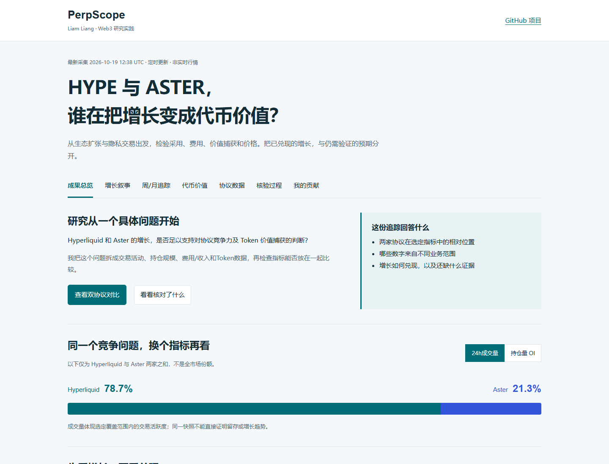

# PerpScope

**HYPE / ASTER 协议增长、叙事兑现与代币价值追踪。** 我把个人 Web3 研究问题，借助 Codex 做成了可运行的数据采集、指标比较与报告流程。

## 直接看成果

### [打开可交互报告，无需安装](https://liamliang0.github.io/perpscope-research/)

先看生态扩张与隐私交易的采用证据，再比较完整日/周/月经营变化、价值捕获和估值负担。可直接切换报告，也能下载本期数据和核对原始接口。

[](https://liamliang0.github.io/perpscope-research/)

线上报告使用最新成功采集的数据；每日 00:25 UTC（北京时间08:25）由 GitHub Actions 尝试更新，失败保留上一份成功结果。页面显示实际采集时间和超过36小时的延迟提示。研究观点另有复核日期，不会因刷新行情自动变成新观点。

**新增：**[增长叙事](https://liamliang0.github.io/perpscope-research/#narratives) · [完整日/周/月对比](https://liamliang0.github.io/perpscope-research/#trends) · [代币价值与验证条件](https://liamliang0.github.io/perpscope-research/#valuation)。费用/收入使用公开历史序列；7/30日成交量历史端点需要付费，未接入前不假造。

[2026-10-04 原始归档](examples/sample_report.md)保留原日期，和线上当前报告分开。

## 这个项目解决什么问题

我研究 Hyperliquid 与 Aster 的竞争和Token价值捕获时，发现“拿到数字”还不够：不同接口的业务范围、持仓定义和历史覆盖可能不同。PerpScope把这些差异一起记录，避免把不能直接比较的数据拼成结论。

## 能具体核实什么

| 成果 | 查看方式 |
|---|---|
| 协议相对位置 | [成交量与OI份额对比](https://liamliang0.github.io/perpscope-research/#overview)，明确仅比较两家协议 |
| 指标口径核验 | [核验过程与原始接口](https://liamliang0.github.io/perpscope-research/#quality)，区分永续业务、母协议和Token层级 |
| 实际交付 | [双协议数据表](https://liamliang0.github.io/perpscope-research/#comparison)、[本期报告](docs/sample_report.md)、[展示数据](docs/report-data.json) |
| 程序检查 | [测试代码](tests/)、[自动检查结果](https://github.com/liamliang0/perpscope-research/actions) |

## 我负责什么

- **研究问题与框架：**从交易活跃、持仓规模、费用/收入追到Token价值捕获，确定需要验证的关系。
- **数据口径与验收：**区分同源OI、母协议收益和永续业务指标；历史不足或数据缺失时保留N/A。
- **AI辅助执行与迭代：**提出需求、配置流程、检查输出，根据实际问题迭代；Codex辅助实现采集、计算、报告与测试。

这是个人研究与AI工作流实践，没有虚构客户、用户增长或投资收益。默认报告使用可检查的规则，可选LLM用于整理结构化数据；不把模板文字冒充独立研究判断。

<details>
<summary>展开运行方法、数据接口与实现细节</summary>

## Simple Windows setup

First time: double-click `setup_perpscope.bat`.

Every day after that: double-click `run_perpscope.bat`.

The daily launcher runs PerpScope and opens `output/daily_report.md` automatically.

## Why I built this

Perp DEX activity changes quickly, but raw volume alone can be misleading.

For example, `Volume +80% / OI +10% / Revenue +8%` describes a different quality of growth from `Volume +80% / OI +70% / Revenue +75%`. The first may reflect short-lived turnover; the second is more consistent with activity, persistent positioning, and monetization expanding together.

PerpScope turns raw protocol data into structured, auditable research signals. It is designed as research support—not a price-prediction system or financial advice.

## What it tracks

- Protocol activity: 24h volume, locally accumulated 7d/30d volume, and open interest
- Capital and monetization: TVL/deposited capital, fees, protocol revenue, and holder revenue when explicitly reported
- Token data: price, circulating market cap, FDV, and price changes
- Derived KPIs: Volume/OI, Fees/Volume, Revenue/Volume, Market Cap / 30D Revenue Run-Rate, and scope-labeled holder-revenue run-rate multiples
- Competitive position: Hyperliquid versus Aster volume and OI shares (two-protocol share, not total market share)
- Changes: 1d, 7d, and 30d comparisons when a comparable source or sufficient local history exists

Every populated metric has a source record with an endpoint and fetch timestamp. Missing or failed metrics remain `N/A`; sample numbers are never inserted into the live report.

**Metric comparability matters as much as metric availability.** PerpScope classifies each source as perps-specific, parent-protocol, token-level, or unknown. Perps operating metrics are kept separate from parent-protocol and token value-capture metrics, and ratios are withheld when their scopes do not align.

## Research philosophy

PerpScope follows a simple causal lens:

**Attention → Flow → Liquidity → Fundamentals**

Attention can create flow, but volume alone does not prove high-quality growth. Open interest helps show whether positioning persists, while fees and revenue test whether activity monetizes. Retention, incentive cost, and participant quality are additional checks—but they are not assumed when public APIs cannot measure them.

Two distinctions matter throughout the report:

- **Volume alone ≠ high-quality growth.** Activity is stronger evidence when volume, OI, and revenue rise together.
- **Protocol success ≠ token value capture.** A successful venue may not transfer equivalent economics to token holders. Holder revenue therefore remains separate from protocol revenue.
- **Pairwise share ≠ global market share.** Relative shares in the report compare only Hyperliquid and Aster unless a true market-wide dataset is explicitly available.

## Architecture

```text
Official APIs / DefiLlama / CoinGecko
                 ↓
        raw timestamped JSON
                 ↓
        normalized snapshots
                 ↓
    history + derived metrics
                 ↓
     transparent signal rules
                 ↓
 deterministic memo (+ optional LLM)
```

Key modules:

- `src/data_sources/`: independently failing API adapters
- `src/models.py`: common `ProtocolSnapshot` schema and source records
- `src/history.py`: daily snapshots and comparable-period calculations
- `src/metrics.py`: derived KPI calculations
- `src/signals.py`: editable, threshold-based research rules
- `src/analysis/`: deterministic thesis logic and constrained optional LLM layer
- `src/report.py`: Markdown rendering

Data is stored under `data/raw`, `data/processed`, and `data/history`. Running more than once on the same UTC day replaces that day's history point. Rolling 7d/30d volume requires complete consecutive UTC calendar-day coverage; a missing day keeps the result N/A. Historical changes use a ±6-hour tolerance around the target lookback and otherwise remain N/A.

## Data sources and methodology

| Dataset | Preferred source | Method |
|---|---|---|
| Hyperliquid 24h volume and official OI cross-check | Hyperliquid official API | `metaAndAssetCtxs` without `dex` covers the default/first perp dex only. Sum asset `dayNtlVlm`; official OI is `openInterest × markPx`. HIP-3 builder-deployed perp dexes are not aggregated. |
| Aster 24h volume | Aster official Futures V3 API | Sum active, non-TEST ticker `quoteVolume`; activity status comes from `exchangeInfo` |
| Comparable OI for both protocols | DefiLlama | One standardized open-interest dataset is used for both pairwise shares |
| Perp fees and revenue | DefiLlama | Standalone `hyperliquid-perps` and `aster-perps` datasets; unavailable fields remain N/A |
| TVL and parent value capture | DefiLlama | Parent-protocol datasets, explicitly separated from perp operations |
| Token price, market cap, FDV | CoinGecko | Coin market endpoint using IDs `hyperliquid` and `aster-2` |
| 7d/30d volume | Local history | Sum one official 24h observation per UTC day only after complete coverage |

The code does not silently fall back to estimated data. A source failure affects its own fields, not the complete run.

## How to run

Requires Python 3.10+.

```bash
python -m venv .venv
# Windows PowerShell
.venv\Scripts\Activate.ps1
pip install -r requirements.txt
python main.py
```

Run tests with:

```bash
pytest -q
```

The default deterministic mode needs no API key. Copy `.env.example` to `.env` only if you want to change settings.

## Optional LLM analysis

Rule-based analysis always works and is the default:

```dotenv
LLM_PROVIDER=none
```

For an OpenAI-compatible endpoint:

```dotenv
LLM_PROVIDER=openai
OPENAI_API_KEY=your_key_here
OPENAI_BASE_URL=https://api.openai.com/v1
OPENAI_MODEL=gpt-4o-mini
```

For Ollama:

```dotenv
LLM_PROVIDER=ollama
OLLAMA_BASE_URL=http://localhost:11434
OLLAMA_MODEL=llama3.1
```

The LLM receives only structured metrics, calculated changes, signals, and declared data gaps. Its prompt requires separate **Facts**, **Interpretation**, and **Unknowns** sections. If it fails, the deterministic report is still generated. Never commit `.env`; it is ignored by Git.

## Limitations

- Aster's official API does not provide a practical aggregate OI endpoint. Pairwise OI therefore uses DefiLlama for both protocols; official Hyperliquid OI remains a separate cross-check.
- DefiLlama's derivatives-volume API requires paid access; PerpScope uses official 24h exchange volume and accumulates longer windows locally.
- Official Hyperliquid and Aster volume fields have aligned perps-only scope but provider-specific calculation. The report discloses this limitation.
- Aster Perps currently exposes fees but not protocol or holder revenue through the tested public summary endpoints. Parent-level holder revenue is labeled separately and never treated as perp revenue.
- A fresh installation cannot make valid local 7d/30d comparisons. The report explicitly says when history is insufficient.
- User retention, incentive/subsidy expenditure, privacy/hidden-order adoption, whale or professional-trader adoption, and Binance/YZi distribution support may require manual or first-party research.
- TVL definitions can differ across protocol architectures and should not be treated as perfectly comparable.
- API definitions and endpoints can change. Raw payload retention makes methodology changes auditable.
- PerpScope supports research; it does not provide financial advice.

## Project structure

```text
perpscope/
├── main.py
├── config/settings.py
├── src/
│   ├── data_sources/
│   ├── analysis/
│   ├── models.py
│   ├── history.py
│   ├── metrics.py
│   ├── signals.py
│   ├── report.py
│   └── pipeline.py
├── data/{raw,processed,history}/
├── output/
└── tests/
```


</details>
